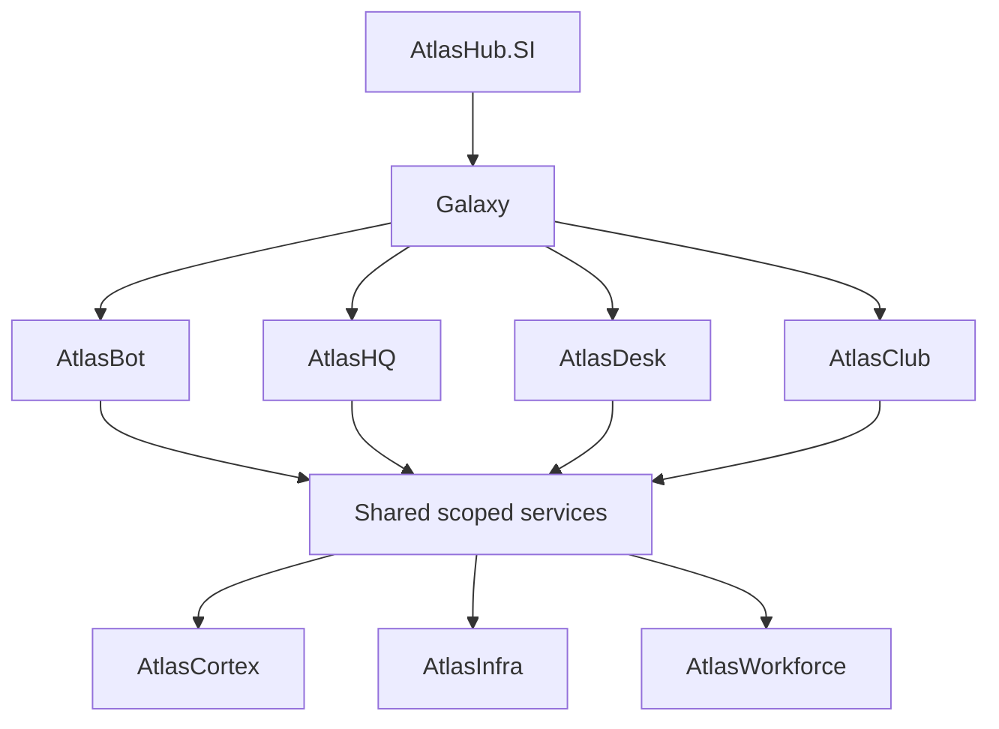

# AtlasHub Galaxy — Command Center

**One intelligence. Multiple worlds. One connected ecosystem.**

[AtlasHub.SI — official website](https://atlashub.si)

AtlasHub Galaxy is the second institutional gateway of AtlasHub and the future role-aware access layer for its interconnected products. Its mission is to present the ecosystem globally, then connect authorized users to relevant products, companies, ventures, teams and operational context.

It is distinct from AtlasHQ, the Paperclip-based enterprise workspace. Galaxy is not a new agent runtime, CRM, or enterprise task database.

| World | Mission |
|---|---|
| AtlasBot | Personal and professional assistants |
| AtlasHQ | Enterprise projects, hybrid workforce and governance |
| AtlasCortex | Scoped memory and knowledge |
| AtlasInfra | Infrastructure, model access and computing |
| AtlasDesk | CRM and future billing |
| AtlasClub | Community, education and team distribution |
| AtlasWorkforce | Reusable agent and team definitions |

## Access vision

Public visitors discover the ecosystem. Authenticated customers, collaborators and operators should later access only authorized products and organizational scopes. SSO, role checks, tenant isolation, audit and real operational data are acceptance requirements, not claims of current implementation.

## Current status

Architecture and discovery, with a temporary living standby screen. The concept image is not a live dashboard. [RFC-001](https://github.com/AtlasHub-Si/AtlasHub-Command-Center/issues/1) remains historical architecture input; the current product distinction is Galaxy for navigation and AtlasHQ for enterprise execution.

## Temporary living standby screen

The root page is a fullscreen text-free Earth/cosmos scene with live particles, no authentication or service calls. Source: Atlas Brand System / Atlas Motion. See [provenance](docs/living-background-provenance.json). Open public/index.html locally or deploy on Vercel with Framework Other, root ., output public, no install/build command or environment variables. Space toggles motion; reduced-motion preferences take precedence. No change to application code or deployment is made by this README.

---
**AtlasHub · Augmented Enterprise · Unified Intelligence** | [Official website](https://atlashub.si) · [Atlas Galaxy](https://github.com/AtlasHub-Si/AtlasHub-Command-Center)
London · Lisbon · Goiânia | AtlasGlobal Tech LTD · AtlasHub Brasil
